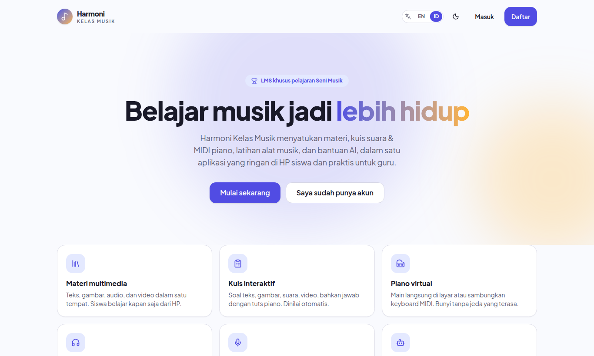
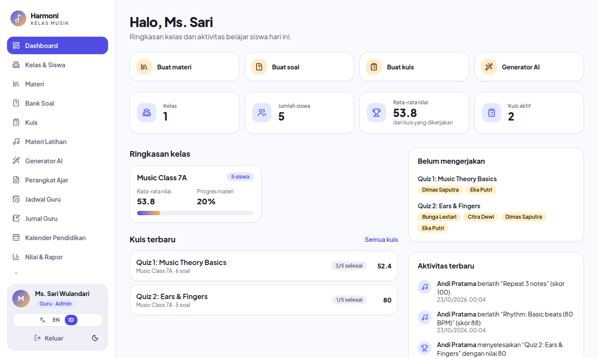
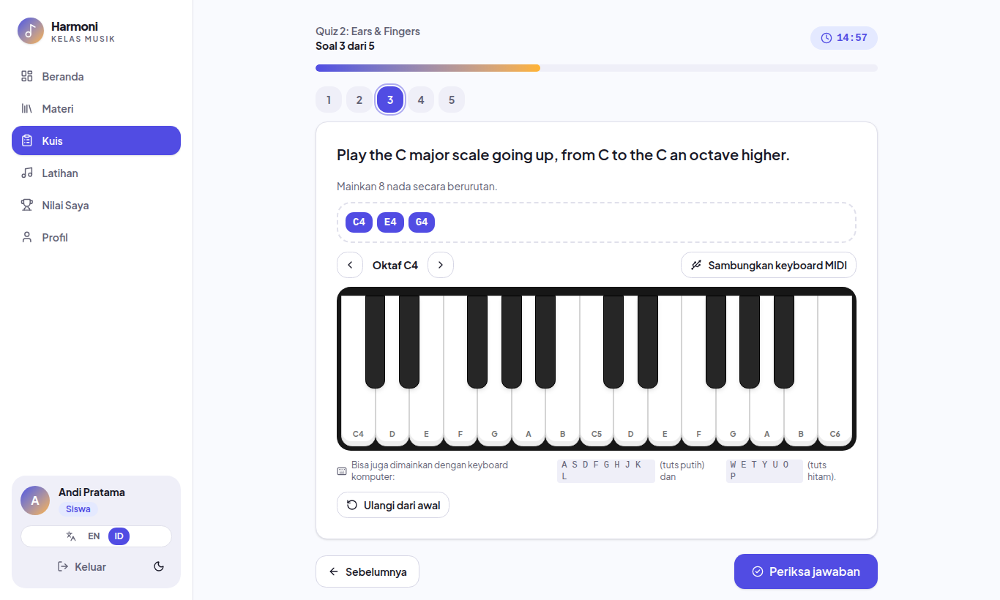
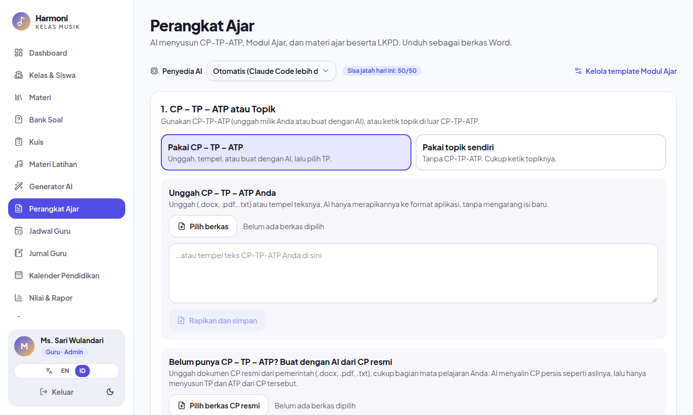
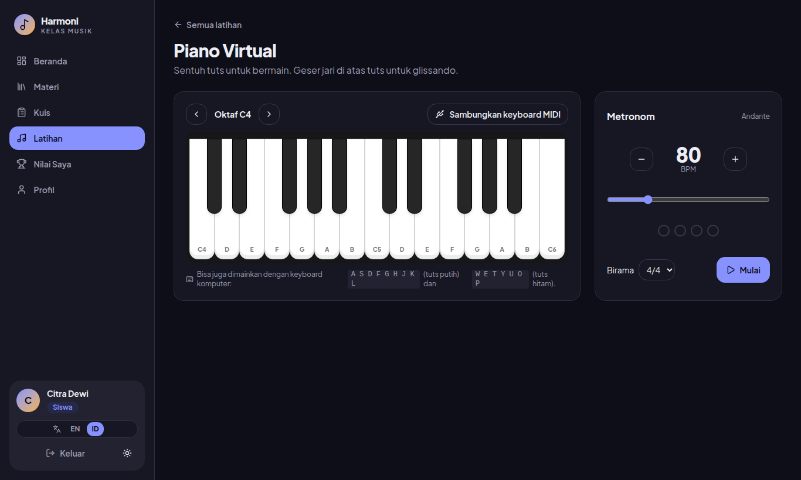
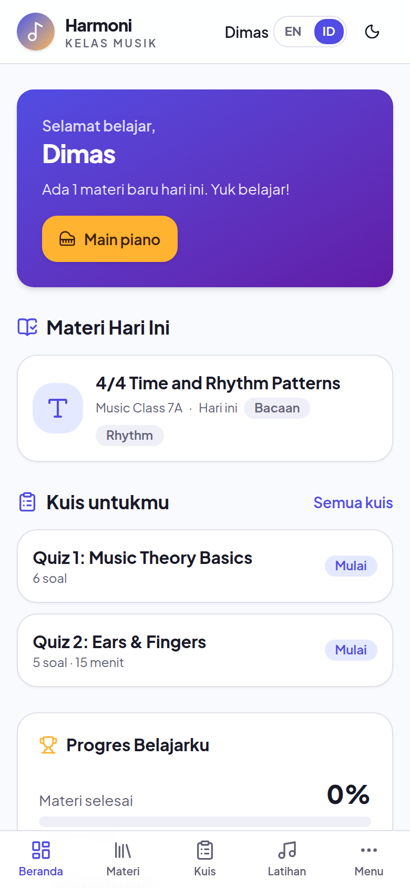

<div align="center">

# 🎵 Harmoni Kelas Musik

**LMS khusus pelajaran Seni Musik: materi, kuis suara & piano MIDI, latihan alat musik, dan perangkat ajar berbantuan AI dalam satu aplikasi.**

[Bahasa Indonesia](README.md) · [English](README.en.md)




</div>

---

Harmoni dibuat oleh guru, untuk guru musik. Siswa belajar dari HP, mengerjakan kuis yang soalnya bisa **didengar** atau **dijawab dengan tuts piano**, dan berlatih nada, ritme, serta interval kapan saja. Guru menyiapkan materi, memantau kelas, menilai, dan menyusun **CP–TP–ATP, Modul Ajar, dan LKPD** dengan bantuan AI, lalu mengunduhnya sebagai berkas Word.

Tampilan berbahasa **Indonesia** secara bawaan dan bisa diganti ke **Inggris** kapan saja (tombol `EN | ID`). Tersedia mode terang dan gelap, dan tampilan diprioritaskan untuk HP.

## Tangkapan layar

**Dashboard guru**: ringkasan kelas, siswa yang belum mengerjakan kuis, dan aktivitas terbaru.



**Kuis dengan jawaban piano**: siswa menjawab dengan menekan tuts di layar, keyboard komputer, atau keyboard MIDI.



**Perangkat Ajar (AI)**: susun CP–TP–ATP, Modul Ajar, dan LKPD, lalu unduh sebagai berkas Word.



**Piano virtual + metronom** (mode gelap).



**Beranda siswa di HP**.

<p align="center"></p>

## Fitur

### Untuk siswa
- **Materi hari ini**: teks, gambar, audio, dan video dalam satu tempat, beserta progres belajar.
- **Kuis interaktif**: pilihan ganda, isian, benar/salah, soal audio & video, dan **soal piano MIDI** (mainkan melodi atau akor). Dinilai otomatis dengan umpan balik langsung.
- **Latihan alat musik**: piano virtual (layar sentuh, keyboard komputer, atau **keyboard MIDI** sungguhan), metronom, latihan nada, ritme, serta latihan pendengaran (interval, akor, tangga nada).
- **Rekam permainan** dengan mikrofon dan dengarkan ulang. Rekaman hanya bisa diputar oleh siswa itu sendiri dan gurunya.
- **Materi latihan** dari guru: lagu, partitur, dan video contoh.

### Untuk guru
- **Kelas & siswa**: kode undangan kelas, tambah akun siswa manual, atau **unggah massal dari Excel**.
- **Materi & bank soal**: editor Markdown dengan media, bank soal per topik/kelas/semester, jadwal terbit.
- **Kuis**: susun dari bank soal, atur waktu, jumlah percobaan, dan umpan balik langsung.
- **Kelas live**: saat jam pelajaran, lihat siswa yang sedang online dan siapa yang sudah membuka materi yang dibagikan.
- **Nilai & rapor**: rekap nilai otomatis, lihat jawaban dan rekaman, penilaian manual, unduh CSV, cetak/PDF.
- **Perangkat Ajar (AI)**: CP–TP–ATP → Modul Ajar → materi guru dengan LKPD + kunci jawaban → materi siswa, diunduh sebagai `.docx`. Bisa memakai template Modul Ajar sekolah sendiri.
- **Generator AI**: draf soal dan ringkasan materi yang bisa diedit sebelum disimpan.
- **Administrasi**: jadwal mengajar, jurnal mengajar + presensi (Hadir/Sakit/Izin/Alpa), dan kalender pendidikan yang dirapikan AI dari dokumen resmi sekolah.

### AI yang fleksibel
AI hanya tersedia untuk guru. Setiap guru memakai **API key Gemini atau Anthropic miliknya sendiri** (diatur di menu **Pengaturan AI**, disimpan terenkripsi), sehingga biaya AI ditanggung masing-masing guru. Gemini punya kuota gratis. Super Admin juga bisa memakai **Claude Code** atau **Ollama** yang terpasang di server. Tanpa AI pun, semua fitur lain tetap berjalan.

### Platform untuk banyak guru
- **Super Admin** (satu akun, yaitu guru pertama yang mendaftar) menyetujui atau menonaktifkan guru, membatasi jumlah guru, dan mengatur ruang upload per guru.
- Guru baru mendaftar lewat formulir atau **akun Google**, wajib mengisi nama sekolah, lalu menunggu persetujuan.
- Super Admin juga punya halaman **Status Server** (CPU, RAM, disk, database) dan **Pengunjung** (siapa yang sedang online).

📖 **Panduan pemakaian lengkap** (login, daftar, peran, dan semua fitur) ada di **[Wiki](https://github.com/djrecycle/LMS_Harmoni/wiki)**.

## Teknologi

| Bagian | Teknologi |
|---|---|
| Framework | Next.js 16 (App Router) + React 19 + TypeScript |
| Tampilan | Tailwind CSS v4, komponen gaya shadcn/ui |
| Database | PostgreSQL + Drizzle ORM. Saat development memakai **PGlite**, jadi tidak perlu memasang PostgreSQL |
| Login | Better Auth (email/username + password, opsional Google untuk guru) |
| Audio & musik | Tone.js, Web Audio API, Web MIDI API, MediaRecorder, VexFlow (notasi balok) |
| Penyimpanan berkas | Disk lokal atau S3-compatible (AWS S3, Cloudflare R2, MinIO, Supabase) |
| Dokumen | docx, ExcelJS, PDFKit |

## Instalasi

Pilih salah satu cara:

| Cara | Cocok untuk |
|---|---|
| [A. VPS dengan domain (Docker + HTTPS)](#a-vps-dengan-domain-docker--https) | Dipakai sungguhan oleh guru dan siswa lewat internet |
| [B. Server lokal / komputer sekolah (Docker)](#b-server-lokal--komputer-sekolah-docker) | Dipakai di jaringan sekolah (LAN) atau satu komputer |
| [C. Mode pengembangan (Node.js)](#c-mode-pengembangan-nodejs) | Mencoba aplikasi atau mengubah kodenya |

### A. VPS dengan domain (Docker + HTTPS)

**Yang dibutuhkan:**
- VPS Linux (Ubuntu 22.04/24.04 atau Debian 12), minimal **2 GB RAM** (disarankan 4 GB) dan 20 GB disk.
- Domain atau subdomain, misalnya `musik.sekolahku.sch.id`.
- Port 80 dan 443 terbuka di firewall VPS.

**1. Arahkan domain ke VPS.** Di pengelola DNS domain, buat **A record** yang mengarah ke IP VPS. Tunggu beberapa menit sampai aktif (cek dengan `ping musik.sekolahku.sch.id`).

**2. Pasang Docker dan Git di VPS** (login ke VPS lewat SSH, lalu):

```bash
curl -fsSL https://get.docker.com | sh
apt-get install -y git
```

**3. Unduh aplikasi:**

```bash
git clone https://github.com/djrecycle/LMS_Harmoni.git /opt/harmoni
cd /opt/harmoni
cp .env.docker.example .env.docker
```

**4. Isi konfigurasi.** Buat dua kata sandi acak:

```bash
openssl rand -base64 32
```

Jalankan dua kali, lalu buka `nano .env.docker` dan isi:

```ini
POSTGRES_PASSWORD=hasil-acak-pertama
BETTER_AUTH_SECRET=hasil-acak-kedua
BETTER_AUTH_URL=https://musik.sekolahku.sch.id
DOMAIN=musik.sekolahku.sch.id
```

Simpan baik-baik isi `.env.docker`. Kalau `BETTER_AUTH_SECRET` berubah, semua orang harus login ulang dan API key AI yang tersimpan harus diisi ulang. Pengaturan lain (email SMTP, login Google, AI) bersifat opsional, lihat [Konfigurasi opsional](#konfigurasi-opsional).

**5. Jalankan:**

```bash
docker compose --env-file .env.docker --profile proxy up -d --build
```

Build pertama memakan waktu 5–15 menit. `--profile proxy` menyalakan **Caddy**, yang otomatis memasang sertifikat HTTPS gratis (Let's Encrypt). HTTPS wajib, karena rekam suara dan keyboard MIDI di browser hanya berjalan lewat HTTPS.

**6. Buat akun Super Admin.** Buka `https://musik.sekolahku.sch.id/register`, pilih **Guru**, dan isi formulir. **Guru pertama yang mendaftar otomatis menjadi Super Admin** dan langsung aktif. Lakukan ini segera setelah aplikasi menyala, sebelum alamatnya dibagikan ke orang lain.

**Cek dan perintah sehari-hari** (jalankan di `/opt/harmoni`):

| Perintah | Fungsi |
|---|---|
| `docker compose --env-file .env.docker ps` | Melihat status layanan (db, app, caddy) |
| `docker compose --env-file .env.docker logs -f app` | Melihat log aplikasi (Ctrl+C untuk keluar) |
| `git pull && docker compose --env-file .env.docker --profile proxy up -d --build` | Memperbarui ke versi terbaru |
| `docker compose --env-file .env.docker --profile proxy down` | Mematikan (data tetap aman) |

Database dan file upload disimpan di volume Docker (`pgdata`, `uploads`), jadi tidak hilang saat aplikasi diperbarui atau dimatikan. **Jangan** menjalankan `down -v`, karena perintah itu menghapus semua data.

**Backup database secara manual:**

```bash
docker compose --env-file .env.docker exec -T db pg_dump -U harmoni harmoni | gzip > /root/harmoni-$(date +%F).sql.gz
```

#### Deploy dari laptop (opsional)

Kalau kamu mengubah kode di laptop, dua skrip ini mengirim perubahan ke VPS tanpa perlu `git pull` di server. Salin `.deploy.env.example` menjadi `.deploy.env`, lalu isi `VPS_HOST` (misalnya `root@203.0.113.10`) dan `REMOTE_DIR` (misalnya `/opt/harmoni`). Laptop harus bisa login SSH ke VPS memakai SSH key.

| Skrip | Fungsi |
|---|---|
| `./deploy.sh` | Menolak jalan kalau ada perubahan yang belum di-commit, mengirim kode ke server, membangun ulang aplikasi, lalu memberi tag `deploy-TANGGAL-JAM` pada commit yang live |
| `./backup.sh` | Dump database + salinan kode di server (5 terbaru), dan mengunduh dump ke `~/harmoni-backups` |

Biasakan menjalankan `./backup.sh && ./deploy.sh`.

### B. Server lokal / komputer sekolah (Docker)

Untuk komputer atau server di sekolah (Windows, macOS, atau Linux).

1. Pasang **Docker Desktop** (Windows/macOS) atau Docker Engine (Linux), lalu **Git**.
2. Unduh aplikasi dan siapkan konfigurasi:

   ```bash
   git clone https://github.com/djrecycle/LMS_Harmoni.git
   cd LMS_Harmoni
   cp .env.docker.example .env.docker
   ```

3. Buka `.env.docker`, isi `POSTGRES_PASSWORD` dan `BETTER_AUTH_SECRET` dengan teks acak (minimal 32 karakter). Biarkan `BETTER_AUTH_URL=http://localhost:3000` kalau hanya dipakai di komputer itu.
4. Jalankan:

   ```bash
   docker compose --env-file .env.docker up -d --build
   ```

5. Buka http://localhost:3000, lalu daftar sebagai **Guru**. Akun pertama ini menjadi Super Admin.

Data contoh (kelas, materi, kuis, dan akun uji) bisa ditambahkan dengan:

```bash
docker compose --env-file .env.docker --profile tools run --rm seed
```

**Dipakai dari komputer lain di jaringan sekolah.** Secara bawaan, aplikasi hanya bisa dibuka dari komputer itu sendiri. Ada dua pilihan:

- **Disarankan:** pakai domain dan HTTPS seperti [cara A](#a-vps-dengan-domain-docker--https). Domain bisa diarahkan ke IP lokal server, tapi Caddy hanya bisa membuat sertifikat otomatis kalau server bisa diakses dari internet.
- **Cepat tapi terbatas:** di `docker-compose.yml`, ubah `"127.0.0.1:${APP_PORT:-3000}:3000"` menjadi `"${APP_PORT:-3000}:3000"`, isi `BETTER_AUTH_URL=http://IP-SERVER:3000`, lalu jalankan ulang perintah langkah 4. Siswa membuka `http://IP-SERVER:3000`. Karena tanpa HTTPS, **rekam suara dan keyboard MIDI tidak berjalan** di komputer lain. Fitur lainnya tetap jalan.

### C. Mode pengembangan (Node.js)

Butuh **Node.js 20.9+** (diuji di Node 22) dan npm. Tidak perlu memasang PostgreSQL, karena mode ini memakai database bawaan (PGlite) di folder `data/`.

```bash
git clone https://github.com/djrecycle/LMS_Harmoni.git
cd LMS_Harmoni
npm install
cp .env.example .env.local     # isi BETTER_AUTH_SECRET: openssl rand -base64 32
npm run db:seed                # buat tabel + data contoh
npm run dev                    # buka http://localhost:3000
```

Akun data contoh (password semuanya `harmoni123`):

| Peran | Login |
|---|---|
| Guru (Super Admin) | `teacher@harmoni.test` |
| Siswa | `student1@harmoni.test` … `student5@harmoni.test` |

> Matikan `npm run dev` (Ctrl+C) sebelum menjalankan `db:seed` atau `db:reset`, karena database PGlite hanya bisa dibuka oleh satu proses.

Perintah lain: `npm run typecheck` (cek kode), `npm run build && npm start` (mode produksi tanpa Docker), `npm run db:reset` (hapus data lokal).

### Konfigurasi opsional

Semua diisi di `.env.docker` (Docker) atau `.env.local` (mode pengembangan), lalu aplikasi dijalankan ulang.

| Fitur | Variabel | Keterangan |
|---|---|---|
| Email lupa password | `SMTP_HOST`, `SMTP_PORT`, `SMTP_USER`, `SMTP_PASS`, `SMTP_FROM` | Tanpa SMTP, tautan reset password hanya muncul di log aplikasi |
| Login Google untuk guru | `GOOGLE_CLIENT_ID`, `GOOGLE_CLIENT_SECRET` | Buat OAuth client (Web application) di Google Cloud. Redirect URI: `https://domainmu/api/auth/callback/google` |
| Kode pendaftaran guru | `TEACHER_SIGNUP_CODE` | Kalau diisi, pendaftar guru wajib memasukkan kode ini |
| AI bawaan server | `GEMINI_API_KEY`, `ANTHROPIC_API_KEY`, `AI_PROVIDER` | Hanya dipakai Super Admin. Guru lain memakai key sendiri dari menu Pengaturan AI |
| Penyimpanan S3 | `STORAGE_DRIVER=s3` + `S3_*` | Kalau file upload ingin disimpan di AWS S3, Cloudflare R2, MinIO, dan sejenisnya |

Daftar lengkap variabel lingkungan dan catatan teknis lain ada di **[README.en.md](README.en.md)**.

## Keamanan singkat

- Peran Super Admin/guru/siswa dicek berlapis: proxy, layout, dan setiap server action.
- Kunci jawaban tidak pernah dikirim ke siswa sebelum soal dijawab; penilaian dan timer dihitung di server.
- Siswa hanya melihat data kelas dan miliknya sendiri. API key AI hanya ada di server dan disimpan terenkripsi (AES-256-GCM).
- Unggahan dicek jenis dan ukurannya; SVG ditolak.

## Batasan yang diketahui

- Suara piano memakai sintesis (Tone.js), bukan sampel piano asli, supaya ringan.
- Web MIDI hanya didukung Chrome/Edge/Opera (desktop & Android). Di Safari/iOS siswa tetap bisa memakai piano di layar.
- Zona waktu tetap WIB.
- Belum ada pengujian otomatis.

## Struktur proyek

```
src/app/         halaman guru, siswa, login, server actions, dan API
src/components/  komponen UI, piano, pemutar media, kuis, latihan, AI
src/db/          skema Drizzle dan koneksi database
src/i18n/        teks Inggris (sumber) + terjemahan Indonesia
src/lib/         auth, penilaian, audio, AI, penyimpanan, perangkat ajar
drizzle/         file migrasi SQL
scripts/         seed, migrate, reset
```

Teks antarmuka ditulis dalam bahasa Inggris di kode (`t("…")`), dan terjemahan Indonesianya ada di `src/i18n/id.ts`.

## Kontribusi

Laporan bug, ide fitur, dan pull request sangat diterima, terutama dari sesama guru musik. Sebelum mengirim PR, jalankan `npm run typecheck`.

## Lisensi

[MIT](LICENSE) © 2026 Rangga (djrecycle). Bebas dipakai, diubah, dan dibagikan, asalkan mencantumkan pemberitahuan lisensi.
