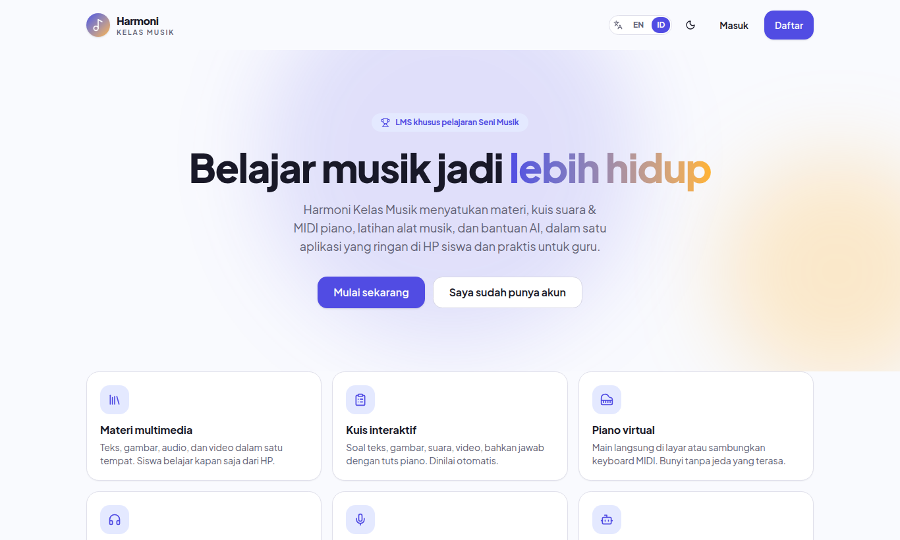
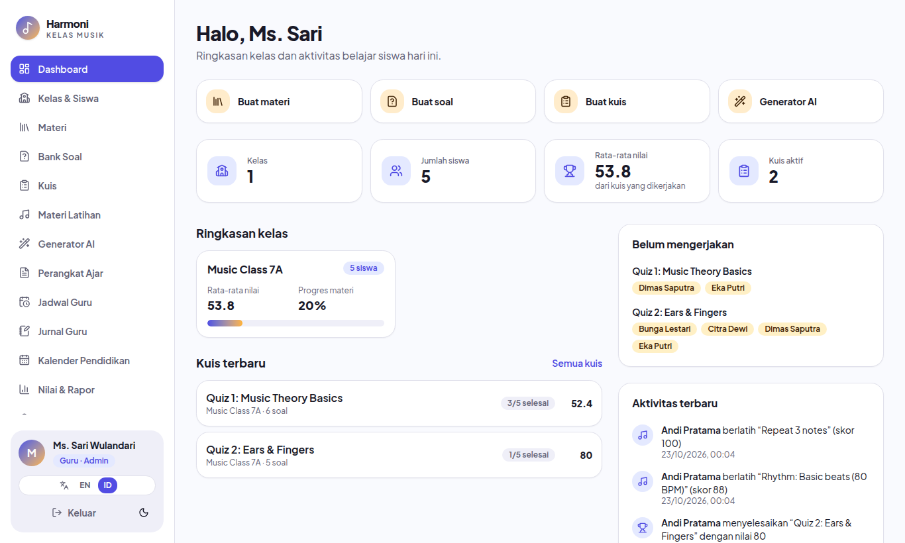
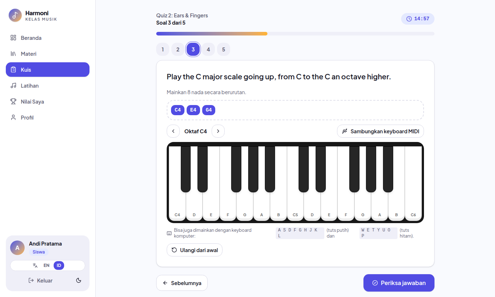
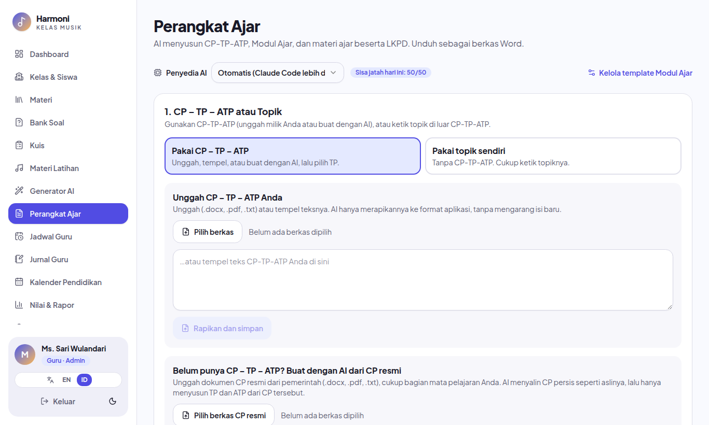
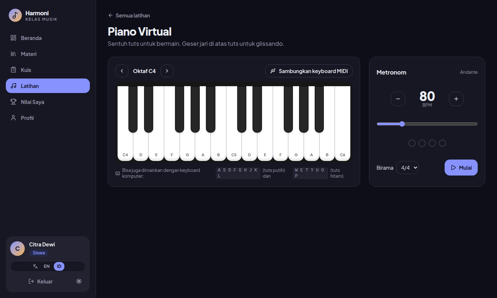
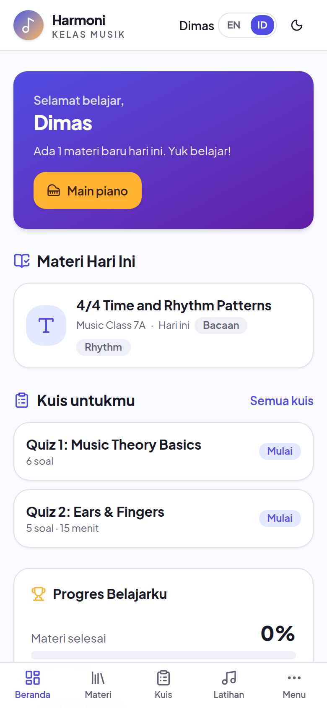

<div align="center">

# 🎵 Harmoni Kelas Musik

**LMS khusus pelajaran Seni Musik: materi, kuis suara & piano MIDI, latihan alat musik, dan perangkat ajar berbantuan AI dalam satu aplikasi.**

[Bahasa Indonesia](README.md) · [English](README.en.md)




</div>

---

Harmoni dibuat oleh guru, untuk guru musik. Siswa belajar dari HP, mengerjakan kuis yang soalnya bisa **didengar** atau **dijawab dengan tuts piano**, dan berlatih nada, ritme, serta interval kapan saja. Guru menyiapkan materi, memantau kelas, menilai, dan menyusun **CP–TP–ATP, Modul Ajar, dan LKPD** dengan bantuan AI, lalu mengunduhnya sebagai berkas Word.

Tampilan berbahasa **Indonesia** secara bawaan dan bisa diganti ke **Inggris** kapan saja (tombol `EN | ID`). Tersedia mode terang dan gelap, dan tampilan diprioritaskan untuk HP.

## Tangkapan layar

**Dashboard guru**: ringkasan kelas, siswa yang belum mengerjakan kuis, dan aktivitas terbaru.



**Kuis dengan jawaban piano**: siswa menjawab dengan menekan tuts di layar, keyboard komputer, atau keyboard MIDI.



**Perangkat Ajar (AI)**: susun CP–TP–ATP, Modul Ajar, dan LKPD, lalu unduh sebagai berkas Word.



**Piano virtual + metronom** (mode gelap).



**Beranda siswa di HP**.

<p align="center"></p>

## Fitur

### Untuk siswa
- **Materi hari ini**: teks, gambar, audio, dan video dalam satu tempat, beserta progres belajar.
- **Kuis interaktif**: pilihan ganda, isian, benar/salah, soal audio & video, dan **soal piano MIDI** (mainkan melodi atau akor). Dinilai otomatis dengan umpan balik langsung.
- **Latihan alat musik**: piano virtual (layar sentuh, keyboard komputer, atau **keyboard MIDI** sungguhan), metronom, latihan nada, ritme, serta latihan pendengaran (interval, akor, tangga nada).
- **Rekam permainan** dengan mikrofon dan dengarkan ulang. Rekaman hanya bisa diputar oleh siswa itu sendiri dan gurunya.
- **Materi latihan** dari guru: lagu, partitur, dan video contoh.

### Untuk guru
- **Kelas & siswa**: kode undangan kelas, tambah akun siswa manual, atau **unggah massal dari Excel**.
- **Materi & bank soal**: editor Markdown dengan media, bank soal per topik/kelas/semester, jadwal terbit.
- **Kuis**: susun dari bank soal, atur waktu, jumlah percobaan, dan umpan balik langsung.
- **Kelas live**: saat jam pelajaran, lihat siswa yang sedang online dan siapa yang sudah membuka materi yang dibagikan.
- **Nilai & rapor**: rekap nilai otomatis, lihat jawaban dan rekaman, penilaian manual, unduh CSV, cetak/PDF.
- **Perangkat Ajar (AI)**: CP–TP–ATP → Modul Ajar → materi guru dengan LKPD + kunci jawaban → materi siswa, diunduh sebagai `.docx`. Bisa memakai template Modul Ajar sekolah sendiri.
- **Generator AI**: draf soal dan ringkasan materi yang bisa diedit sebelum disimpan.
- **Administrasi**: jadwal mengajar, jurnal mengajar + presensi (Hadir/Sakit/Izin/Alpa), dan kalender pendidikan yang dirapikan AI dari dokumen resmi sekolah.

### AI yang fleksibel
AI hanya tersedia untuk guru dan bisa memakai salah satu dari: **Claude Code** (tanpa API key bila sudah login di server), **Anthropic API**, **Gemini API**, atau **Ollama** (lokal & gratis). Admin mengatur penyedia, API key (disimpan terenkripsi), dan batas pemakaian harian per guru dari menu **Pengaturan AI**. Tanpa AI pun, semua fitur lain tetap berjalan.

## Teknologi

| Bagian | Teknologi |
|---|---|
| Framework | Next.js 16 (App Router) + React 19 + TypeScript |
| Tampilan | Tailwind CSS v4, komponen gaya shadcn/ui |
| Database | PostgreSQL + Drizzle ORM. Saat development memakai **PGlite**, jadi tidak perlu memasang PostgreSQL |
| Login | Better Auth (email/username + password, opsional Google) |
| Audio & musik | Tone.js, Web Audio API, Web MIDI API, MediaRecorder, VexFlow (notasi balok) |
| Penyimpanan berkas | Disk lokal atau S3-compatible (AWS S3, Cloudflare R2, MinIO, Supabase) |
| Dokumen | docx, ExcelJS, PDFKit |

## Mulai cepat

Butuh **Node.js 20.9+** (diuji di Node 22) dan npm. Clone repo ini, lalu:

```bash
npm install
cp .env.example .env.local     # isi BETTER_AUTH_SECRET: openssl rand -base64 32
npm run db:seed                # buat tabel + data contoh
npm run dev                    # buka http://localhost:3000
```

Akun data contoh (password semuanya `harmoni123`):

| Peran | Login |
|---|---|
| Guru (admin) | `teacher@harmoni.test` |
| Siswa | `student1@harmoni.test` … `student5@harmoni.test` |

> Matikan `npm run dev` (Ctrl+C) sebelum menjalankan `db:seed` atau `db:reset`, karena database lokal PGlite hanya bisa dibuka satu proses.

Akun guru sendiri dibuat lewat `/register` → pilih **Guru**. **Guru pertama yang mendaftar otomatis menjadi admin.** Di server publik, isi `TEACHER_SIGNUP_CODE` supaya orang asing tidak bisa mendaftar sebagai guru.

## Menjalankan di server (Docker)

```bash
# Salin contoh konfigurasi, lalu isi POSTGRES_PASSWORD,
# BETTER_AUTH_SECRET, dan BETTER_AUTH_URL di .env.docker
cp .env.docker.example .env.docker
docker compose --env-file .env.docker up -d --build
```

Untuk VPS dengan domain sendiri, isi `DOMAIN` di `.env.docker`, arahkan DNS ke server, lalu tambahkan `--profile proxy` agar **Caddy** memasang HTTPS otomatis. HTTPS wajib, karena perekaman suara dan MIDI di browser hanya jalan lewat HTTPS.

Ada dua skrip bantu yang dijalankan dari komputermu (alamat server diatur di `.deploy.env`, salin dari `.deploy.env.example`):

| Skrip | Fungsi |
|---|---|
| `./deploy.sh` | Menolak jalan kalau ada perubahan yang belum di-commit, mengirim kode ke server, membangun ulang aplikasi, lalu memberi tag `deploy-TANGGAL-JAM` pada commit yang live |
| `./backup.sh` | Dump database + salinan kode di server (5 terbaru), dan mengunduh dump ke `~/harmoni-backups`. Jalankan sebelum deploy yang mengubah database |

Daftar lengkap variabel lingkungan, opsi penyimpanan S3, deploy ke Vercel, dan catatan keamanan ada di **[README.en.md](README.en.md)**.

## Keamanan singkat

- Peran guru/siswa dicek berlapis: middleware, layout, dan setiap server action.
- Kunci jawaban tidak pernah dikirim ke siswa sebelum soal dijawab; penilaian dan timer dihitung di server.
- Siswa hanya melihat data kelas dan miliknya sendiri. API key AI hanya ada di server dan disimpan terenkripsi (AES-256-GCM).
- Unggahan dicek jenis dan ukurannya; SVG ditolak.

## Batasan yang diketahui

- Suara piano memakai sintesis (Tone.js), bukan sampel piano asli, supaya ringan.
- Web MIDI hanya didukung Chrome/Edge/Opera (desktop & Android). Di Safari/iOS siswa tetap bisa memakai piano di layar.
- Zona waktu tetap WIB.
- Belum ada pengujian otomatis.

## Struktur proyek

```
src/app/         halaman guru, siswa, login, server actions, dan API
src/components/  komponen UI, piano, pemutar media, kuis, latihan, AI
src/db/          skema Drizzle dan koneksi database
src/i18n/        teks Inggris (sumber) + terjemahan Indonesia
src/lib/         auth, penilaian, audio, AI, penyimpanan, perangkat ajar
drizzle/         file migrasi SQL
scripts/         seed, migrate, reset
```

Teks antarmuka ditulis dalam bahasa Inggris di kode (`t("…")`), dan terjemahan Indonesianya ada di `src/i18n/id.ts`.

## Kontribusi

Laporan bug, ide fitur, dan pull request sangat diterima, terutama dari sesama guru musik. Sebelum mengirim PR, jalankan `npm run typecheck`.

## Lisensi

[MIT](LICENSE) © 2026 Rangga (djrecycle). Bebas dipakai, diubah, dan dibagikan, asalkan mencantumkan pemberitahuan lisensi.
